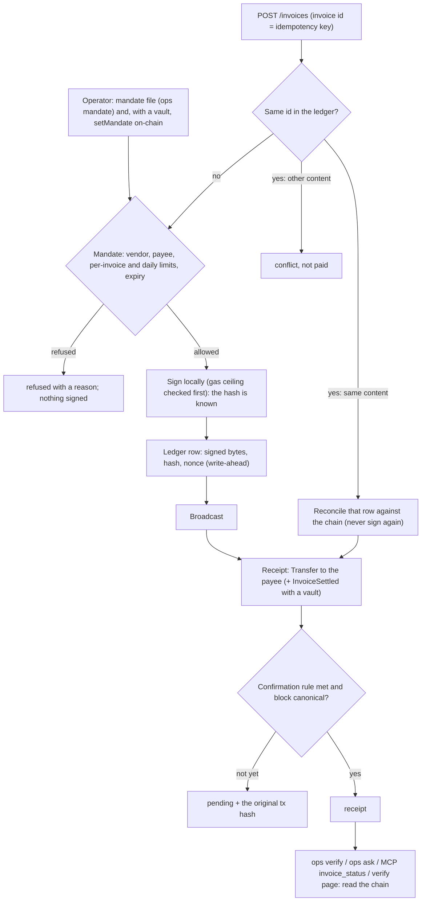

# AgentFi invoice agent (QDay Aevum Builder Challenge)

**One invoice, one payment, one receipt.** An operator approves an agent in advance to pay a known vendor up to a limit per invoice. Invoices arrive; the agent checks the vendor, the payee address and the limits, pays in tUSD8 with a plain ERC-20 transfer, and returns a receipt the operator can check on-chain. The same invoice id is paid at most once, including when the agent dies after the payment went out and before it could answer (the exact guarantee and its conditions: [What is guaranteed](#what-is-guaranteed-and-under-which-conditions)).

> **Status (2026-11-26).** **One public payment has been made on Aevum Testnet (chain 44005)**, a test network with test tokens, through the `InvoiceMandate` vault and the official tUSD8: [check it yourself](#the-first-public-payment-on-aevum-check-it-yourself). The demo, the tests and the rehearsals run on a **local Anvil chain** (chain id 31337) with a **local test ERC-20** (`tUSD8-LOCAL`: 6 decimals like QDay's tUSD8, open mint, deployed by the demo; *not* QDay's tUSD8) and demo data. What is still open: [What is missing for Aevum Testnet](#what-is-missing-for-aevum-testnet).

## For a reviewer: where each answer is

| Question | Short answer | Where to look |
|---|---|---|
| What was built for the challenge? | This package (19–26 Nov 2026): the invoice agent, its write-ahead ledger, the `InvoiceMandate` vault, the operator CLI, the read-only MCP tools, the preflight and session, the verification page (with its resend simulation), and `erc8004/` (ratings anchored in settled invoices, local, not deployed). One pre-existing AgentFi function is reused. | [Before the challenge vs. built for the challenge](#agentfi-before-the-challenge-vs-built-for-the-challenge) |
| How do I run the demo? | `npm ci` at the repository root, then `npm run demo` (and `npm run demo:vault`) in this folder. Local chain, no key, no network. | [Run it](#run-it) |
| Where does the operator set the mandate? | Off-chain: `npm run ops -- mandate …` writes the file the agent reads. On-chain: `setMandate` on the vault (`contracts/script/InvoiceMandate.s.sol`). The agent refuses to start when the two disagree. | [The on-chain vault](#the-on-chain-vault-invoicemandate), `src/mandate.ts`, `src/ops.ts` |
| Who signs what? | The agent key signs only the payment (`payInvoice`, or a direct `transfer`). The operator's key signs deploy, deposit, `setMandate`, pause, withdraw. The vendor signs nothing. | [Three keys, three roles](#aevum-testnet-the-owners-three-transactions) |
| What if the agent crashes after broadcasting? | The signed transaction was recorded in the ledger before it was sent, so the resend finds it by hash and answers with the original transaction; nothing new is signed. | [How it works](#how-it-works), `src/payer.ts`, `test/lost-response.test.ts`, `test/vault.test.ts` |
| Where do I see there was a single transfer? | On-chain: the vault's `settlementOf` and the transaction's two logs. Locally: `ops verify` counts every transfer to the payee since the session's first block, in pages; a page that fails makes the check INCOMPLETE, never verified. | [Check it yourself](#the-first-public-payment-on-aevum-check-it-yourself), `test/log-pages.test.ts` |
| How do I check the proof without a wallet? | Open the verification page link, or run the three `cast` reads below: public RPC, no key. | [Check it yourself](#the-first-public-payment-on-aevum-check-it-yourself) |
| Can another system mark its invoice paid from this? | A versioned JSON receipt and a read-only check against your own invoice record and the chain; `npm run ap:demo` shows an accounts-payable system doing it once, across restarts, outages and concurrent deliveries. | [Portable receipt](#portable-receipt-can-another-system-mark-its-invoice-paid) |

The path of one invoice, from the mandate to the receipt:



## The first public payment on Aevum: check it yourself

On 2026-11-24 the owner ran the public vault session (`npm run session -- --aevum --vault …`, tip cap 1 gwei, gas ceiling 0.0002 tQDAY) from this code, at commit `7382b7f`. **Aevum Testnet only**: test tokens, no real funds. Every value below is public; none of the checks needs a key, the agent or its ledger.

**Three links, no wallet needed:**
- **The invoice, checked live in your browser:** [agentfi.cc/verify: QDAY-2026-11-24-001](https://www.agentfi.cc/verify/index.html?vault=0xA0BfD474378bB8F7Ee96294313a3832B26f4D7A3&invoice=QDAY-2026-11-24-001). It reads the chain over the public RPC and shows "Paid and verified" with the settlement, the event, the transfer and the finalized block.
- **The vault's source on the explorer:** [InvoiceMandate on Blockscout](https://explorer-test.qday.info/address/0xA0BfD474378bB8F7Ee96294313a3832B26f4D7A3?tab=contract), shown as **"Contract Source Code Verified (Partial Match)"**. It is "Partial" because the build omits the metadata hash (`bytecode_hash = "none"`, no CBOR), which Blockscout needs for a full match; the deployed code is the build of this source byte for byte.
- **The payment transaction:** [0x2567…6d4b on the explorer](https://explorer-test.qday.info/tx/0x2567affd1917fed9055e7ad8ed517845e41ed9b356ccb8f954bc458030976d4b).

| | |
|---|---|
| Network | Aevum Testnet, chain 44005, RPC `https://rpc-test.qday.info`, explorer `https://explorer-test.qday.info` |
| Token | official tUSD8 `0x456569838f1d43009A91ebA4263147Afd7233483` (6 decimals) |
| Vault | `0xA0BfD474378bB8F7Ee96294313a3832B26f4D7A3`: deploy `0x69c123b31bbefe5059352f9271a13ecee54843573f1b0a77c7d1c88be24078d9`, deposit of 1 tUSD8 `0x3282891cfe19b59309ceae59d2cbebff9581355bce905485625a6b22faec03d3`, mandate `0x243a3eb37b49fb464ee4734bc716bea9887768d904d4d00848558bdc9dfbb88f` (signed by the operator) |
| Invoice | `QDAY-2026-11-24-001`, 1 tUSD8, vendor id `vendor-1`, payee `0x46fbCbbA2b425AdFB958507F5F341FCc4932C530` |
| Payment | [`0x2567affd1917fed9055e7ad8ed517845e41ed9b356ccb8f954bc458030976d4b`](https://explorer-test.qday.info/tx/0x2567affd1917fed9055e7ad8ed517845e41ed9b356ccb8f954bc458030976d4b), `payInvoice` sent by the agent key `0x7CA8B7704a214b9c129c166c80b5eDB28500DbC8`, block 4,030,463, gas used 118,617 |

The mandate was set for one day and expired on 2026-11-25 17:16:30 UTC: the verification page shows a past expiry, the settlement and the receipt stay verifiable, and simulating the same payment today reverts `MandateExpired` rather than `AlreadySettled` (why: [the order of the vault's checks](#the-on-chain-vault-invoicemandate)).

Three different claims, checked separately:

1. **Included.** On the explorer page: status success, block 4,030,463, and exactly two logs: the vault's `InvoiceSettled` (this invoice, `vendor-1`, this payee, 1,000,000 units, this agent) and the tUSD8 `Transfer` vault → payee of 1,000,000 units. From a shell, the receipt's block hash must equal the canonical block hash at that height:

   ```bash
   R=https://rpc-test.qday.info; TX=0x2567affd1917fed9055e7ad8ed517845e41ed9b356ccb8f954bc458030976d4b
   cast receipt $TX --rpc-url $R                                   # status 1, blockHash, the two logs
   cast block 4030463 --field hash --rpc-url $R                   # must be the receipt's blockHash
   cast call 0xA0BfD474378bB8F7Ee96294313a3832B26f4D7A3 'settlementOf(string,bytes32)(bool,uint256,uint256,address,bytes32)' \
     QDAY-2026-11-24-001 $(cast format-bytes32-string vendor-1) --rpc-url $R   # settled, by that agent, in that block
   ```

2. **Final.** The agent, `ops verify` and the verification page count a payment as paid only once its block is at or below the node's `finalized` block (Aevum's lags the head by an hour or more, and moves in jumps): `cast block finalized --field number --rpc-url $R` must be ≥ 4030463. Until then the honest answer is "included, awaiting finality".
3. **The operator's `ops verify`.** It checks the agent's own receipt (from its ledger) against the chain and counts every transfer from the vault to the payee since the session's first block. The ledger stays on the operator's machine (`.sessions/`, ignored by git); a third party does not need it, the two checks above read only the chain.
   - **In the session (`7382b7f`) it stopped:** the Aevum RPC refuses `eth_getLogs` over more than 1,000 blocks, and the count asked for more.
   - **After the fix (`0b71785`, pages of at most 1,000 blocks)** it was run again, with no key and nothing sent, on a copy of the session's ledger. Result: **VERIFIED**. The block is finalized, the vault's settlement, event and transfer agree, and it found **one transfer to the payee in the window examined**, matched to this invoice.

The lost-answer step of that session (the agent killed right after the broadcast, the same invoice resent, the **original hash** returned and nothing new signed) is in the session's transcript, also on the owner's machine.

## Run it

Needs **Node 22.13+** (the ledger uses the built-in `node:sqlite`) and Foundry's **`anvil`** ([install Foundry](https://book.getfoundry.sh/getting-started/installation): `curl -L https://foundry.paradigm.xyz | bash`, then `foundryup`; found on `PATH` or in `~/.foundry/bin`). `forge` is needed only for the contract tests and `npm run build:token`. No wallet, key, faucet or public network is needed: everything runs on your machine (checked on Linux in CI and on Windows 11 with Git Bash and PowerShell 7).

```bash
git clone https://github.com/felippeyann/agentfi.git
cd agentfi
npm ci                 # at the repository root (npm workspaces, one lockfile): installs the whole monorepo, a few minutes
cd packages/invoice-agent
npm run demo           # 20-40 s: starts anvil and the agent, runs the scenario, checks invariants, stops everything
npm run demo:vault     # the same scenario paid through the on-chain InvoiceMandate vault, plus a lost ledger and a pause
npm test               # every test file on a local chain (lost response, races, RPC failures, the lock, guards, confirmation rule and reorgs, the vault path, the tip cap, the verification page and its resend simulation, the session's `--probe-paid`), about 1 to 2 minutes; it prints the count
npm run typecheck      # tsc --noEmit over src/ and test/
```

The contract's own tests (Foundry; forge-std is the monorepo's submodule `packages/contracts/lib/forge-std`, so fetch it once from the repository root, or clone with `--recurse-submodules`):

```bash
git submodule update --init packages/contracts/lib/forge-std    # from the repository root
cd packages/invoice-agent/contracts
forge test                                                      # unit, review and fuzz tests; the fork test is skipped
AEVUM_FORK=1 forge test --match-contract AevumForkTest           # opt-in: a local fork of Aevum with the real tUSD8 (reads the public RPC)
```

See [The on-chain vault](#the-on-chain-vault-invoicemandate). Versions, generated files and CI: [Dependencies, toolchain and CI](#dependencies-toolchain-and-ci).

**What to expect.** The demo prints each step (below) with the agent's answer, the operator's `ops verify` / `ops status` output and a `✓` per invariant, and ends with `OK: every invariant held.` and exit code 0 (a broken invariant prints `✗ INVARIANT BROKEN` and exits 1). `npm test` may print `ExperimentalWarning: SQLite is an experimental feature`: the ledger uses Node's built-in `node:sqlite`; the warning is expected.

**Where the receipt is.** The agent answers `POST /invoices` with JSON; when paid, `receipt` holds `invoiceId`, `invoiceHash`, `chainId`, `token`, `from`, `to`, `amount` (and `amountUnits`, 6 decimals), `txHash`, `blockNumber`, `logIndex`. The demo prints INV-001's receipt in full and checks it with `npm run ops -- verify INV-001`, which reads the transaction and its `Transfer` log from the chain. The same receipt is kept in the ledger (a SQLite file, one row per invoice, plus an event log). The transcript, ledger and mandate go to a temporary folder printed at the start and at the end (`DEMO_TRANSCRIPT=<file>` chooses the transcript path). Anvil is stopped at the end, so the chain itself does not outlive the run. Ports: Anvil 8566, agent 8787, and the next port (8788) for the second agent that must refuse to start (`DEMO_ANVIL_PORT`, `DEMO_AGENT_PORT`; the session takes `--anvil-port` / `--agent-port`, default 8567 / 8788).

**The keys are Anvil's public development keys** (from Foundry's published `test … junk` mnemonic): fine on a local chain, swept within seconds on any real one. The agent refuses them, and the simulated crashes (`INVOICE_FAIL_AT`), when the mandate names any chain other than Anvil's 31337; and the agent and `ops` refuse to run, and the agent to sign, when the node behind `INVOICE_RPC_URL` serves another chain than the mandate's (`eth_chainId`), so a 31337 mandate pointed at a public RPC stops before anything is signed.

**Running the agent and `ops` yourself** (outside the demo, against your own Anvil): `INVOICE_RPC_URL` (the node), `INVOICE_MANDATE` (the mandate JSON, written with `npm run ops -- mandate …`), `INVOICE_LEDGER` (the SQLite ledger; a `.lock` file appears next to it while the agent runs), and for the agent only `INVOICE_PAYER_KEY` and `INVOICE_PORT` (default 8787). Optional: `INVOICE_CONFIRMATION` (`finalized`, `depth:N`, or `inclusion` on Anvil only), `INVOICE_EXPLORER_URL` (default for 44005: the official explorer), `INVOICE_LOGS_FROM_BLOCK` (first block of the `Transfer` counts), `INVOICE_MAX_GAS_COST` (gas ceiling per transaction in the native coin; required for the agent off 31337). Then `npm run server` and `npm run ops -- status | verify <id> | reconcile`. Inside the demo, `ops verify INV-001` runs while Anvil is still up.

A 3-minute walkthrough of the same run: [DEMO-SCRIPT.md](DEMO-SCRIPT.md).

**Tried it? Tell us where it broke or worked.** No key is needed: open the **Alpha feedback** form from [the issue chooser](https://github.com/felippeyann/agentfi/issues/new/choose) (a free GitHub account; no account-free channel yet), answer the install and first-flow questions for the command you ran, pick the mode "Other" and write `invoice-agent`, the command you ran (`npm run demo`, `npm test`, `npm run mcp:fixture`, …), your OS, Node and `anvil --version`, and the last lines of the output. A **Bug report** works too (package "other", say `invoice-agent`). What we ask and never collect: [docs/feedback.md](../../docs/feedback.md); do not paste keys or seeds. Vulnerabilities go to the [private advisory form](https://github.com/felippeyann/agentfi/security/advisories/new), never to a public issue.

## What the demo shows

1. **The operator authorizes in advance** (`mandate.json`): pay vendor `acme` at its registered address, ≤ 10 tUSD8 per invoice, ≤ 50 per day. The agent reads it and cannot change it.
2. **INV-001, 8 tUSD8 → paid.** The agent answers with a receipt (tx hash, block, log index, from, to, amount). `npm run ops -- verify INV-001` checks it against the chain: `VERIFIED`, one Transfer of 8 tUSD8.
3. **INV-001 again → replayed**: the same receipt, the same tx hash; on-chain still one transfer, payer 100 → 92. INV-001 with a different amount → `conflict`, not paid. A second agent process started on the same ledger refuses to start.
4. **INV-002 (12 tUSD8) → refused**: "above the 10 tUSD8 per invoice the operator approved". **INV-003 (payee changed) → refused**: "not Acme Data Ltd's registered address … a changed bank detail is the classic invoice fraud", with what to do. No transfer, the changed payee received nothing.
5. **The failure that matters.** INV-004: the agent broadcasts the payment and is killed before answering (the caller sees `ECONNRESET`). Resubmitted after a restart → **recovered**: the payment is found on-chain, nothing new is signed or sent, exactly one transfer, the one in the receipt.
6. **Same crash while nothing is being mined** (INV-005): every resubmission answers **PENDING** with the tx hash ("NOT sent again"), `ops verify` says "NOT on-chain yet. Do not pay again; run reconcile"; once a block is mined, `ops reconcile` confirms it and the next resubmission returns that receipt (as `replayed`, since the operator's reconcile confirmed it first).
7. **Crash after recording, before broadcasting** (INV-006): resubmitted → the **same signed transaction** (same hash, same nonce) is sent; still one transfer.

End state, checked by the script: 4 transfers from the payer (8 + 3 + 2 + 1 = 14 tUSD8), payer 86, vendor 14, changed payee 0.

## How it works

**The payment** is `token.transfer(payTo, amount)` sent by the payer's own address (an externally owned account). The token contract moves the balance and emits `Transfer(payer, payTo, amount)`. No escrow contract, no allowance, no relayer; the agent pays gas in the native coin (tQDAY on Aevum).

**One payment per invoice id.** The invoice id is the idempotency key. The ledger (SQLite, `node:sqlite`) has one row per id; a second submission is answered from that row and the chain, never by signing again. Same id with different content (payee or amount) is a `conflict`.

**Write-ahead before broadcast.** The agent signs the transfer locally, so the transaction hash is known before anything is sent, and commits the signed bytes, hash and nonce to the ledger **before** broadcasting. After a crash, a resubmission reconciles that row against the chain:

| The chain says | Answer | Money |
|---|---|---|
| mined, success, Transfer payer → payTo of the exact amount, the block meets the [confirmation rule](#when-the-operator-can-trust-the-receipt) and is canonical | `recovered` (or `replayed` if already confirmed): the receipt | moved once |
| mined and matching, the rule not met yet (or the block at that height changed) | `pending`, stage `included`, + tx hash, block, explorer link: "do not treat it as paid yet"; ask again any time | moved once (not final) |
| it was in a block, and that block left the canonical chain | back to "sent": found in the mempool → `pending`; unknown and the nonce unused → the **same signed bytes** are sent again | moves once |
| known to the node, not mined | `pending` + tx hash + "run `ops reconcile`" | not sent again |
| unknown to the node, the payer's nonce still unused | rebroadcast the **same signed bytes** (same hash: can be mined at most once) | moves once |
| unknown to the node, but the payer's nonce is used | `unresolved` (row `stuck`, kept open and checked again every time): "Do NOT pay this invoice again", look up the payer's transaction at that nonce. Another transaction may have used the nonce, or the node has not indexed ours: the agent cannot tell, so it never says "no money moved". Once the operator has checked, `ops resolve <id> --not-paid --by NAME --note …` closes it as not paid (it refuses if the transaction has appeared on-chain meanwhile) | unknown |
| mined but reverted | `failed`: no tokens moved, operator decides | none |
| the RPC fails (timeout, 5xx, …) on a resubmission | `pending` with the hash and the last known state: "Could not read the chain … Do NOT pay this invoice again"; the row is left as it was, nothing is decided from a failed read (`ops verify` exits with the error) | — |
| the RPC fails while a NEW payment is broadcast or its receipt awaited | `pending` + tx hash: "may already be on-chain … Do NOT pay this invoice again, under this id or another"; resubmitting the same id reconciles it | maybe moved, once |

Before signing a new invoice, open rows are reconciled first (one that cannot be settled right now does not block new invoices), and a new nonce never reuses the nonce of a signed-but-unsent payment (tested). If the id was taken between the check and the write, the freshly signed bytes are discarded, never sent. A refused invoice signed nothing, so a resubmission is judged again (it is paid if the operator has since raised the limit).

## What is guaranteed, and under which conditions

- **At most one payment per invoice id**, with **one agent process per ledger file**: the agent holds an exclusive lock (a SQLite file next to the ledger, locked for the life of the process) and a second process refuses to start. The operating system releases the lock when the process dies, however it dies, so a restart after a crash starts at once and there is no stale lock to take over (tested: ten processes starting together after a crash, exactly one runs). Two agents on different machines with separate ledgers are not protected against each other.
- **Deduplication is only as good as the invoice id and the ledger.** The id is the key, exactly as written (case-sensitive): `INV-001` and `inv-001` are two invoices, and the same invoice resent under a new id is a new invoice, paid again if the mandate allows it (the per-invoice and daily limits still apply). The vendor's own invoice number is the natural key; whoever submits invoices must keep it stable. The memory is the ledger file: an agent started on a new or different ledger does not know earlier payments (their `Transfer` logs stay on-chain and `ops status` lists them, but the agent does not match them to invoices on its own). **With the on-chain vault** this limit goes away for the same invoice id: the chain itself refuses a second settlement and answers "was it paid?" without the ledger ([The on-chain vault](#the-on-chain-vault-invoicemandate)). A ledger is bound to the chain, token and payer it was first used with; the agent and `ops` refuse it under another one (the mandate's limits, expiry and vendor may change).
- **The mandate is checked when written and every time it is read**: limits must be plain decimals above 0 (`10`, `2.5`; not `1e1`), the expiry a valid date or `null`, the addresses valid. A malformed mandate stops the agent instead of loosening the limits.
- **With the on-chain vault**, the chain adds its own guarantees and limits: one settlement per (invoice id, vendor), a payment only to the vendor and payee the agent judged, and a daily limit per **calendar UTC day** (up to 2× around midnight; a stolen agent key can move at most the daily limit per day until the expiry, to the registered payee only, and can dust-settle future invoice ids). Details: [The on-chain vault](#the-on-chain-vault-invoicemandate).
- **A payment is `confirmed` only under the chain's confirmation rule** ([below](#when-the-operator-can-trust-the-receipt)): one block on the local Anvil demo, the node's `finalized` block on Aevum. Until then it is `pending` with its hash.
- **A transaction that stays in the mempool** is reported `pending` with its hash: there is no fee bump or replacement. The operator stops there and checks the payer in the explorer; the session command stops by itself after 10 minutes without a block.
- **`ops verify` reads the chain**, and it also uses the agent's ledger to know which transaction belongs to which invoice: it fails when the receipt's block or log differ from the ledger, or when a transfer to that payee is not matched to an invoice.

Tested on a local chain (`npm test`; which file covers what: [Files](#files)): crash after broadcast, after signing, while nothing is mined; a transaction dropped from the mempool is resent with the same bytes; two writers racing on one invoice; RPC failures during the resubmission and right after a new payment is sent; a node serving another chain; the nonce taken by another transaction; refusal, conflict, re-judged refusal; and the confirmation rule: pending until finalized, a block that leaves the canonical chain before the rule is met (dropped, or replaced by a reorg), a depth confirmation withdrawn after a deeper reorg, a receipt inconsistent with the block at its height, the finalized block unreadable; and the gas ceiling: a maximum exactly at the ceiling is paid, 1 wei above is refused, a fee rise after an approved preflight is refused (zero signatures, zero transmissions), a payment already sent stays recoverable when fees rise.

### Threat model, in short

| | What | Backed by |
|---|---|---|
| **Guarantee** | One payment per invoice id: per ledger without a vault, per (invoice id, vendor) on-chain with one | `test/lost-response.test.ts`, `test/review-fixes.test.ts`; `contracts/test/InvoiceMandate.t.sol`, `test/vault.test.ts` ("a NEW ledger …") |
| **Guarantee** | A crash at any point (after signing, after broadcasting, while nothing is mined) never produces a second signed payment | `test/lost-response.test.ts`, `test/vault.test.ts`; the public session's resend returned the original hash (owner's transcript) |
| **Guarantee** | "Paid" only once the block meets the confirmation rule and is canonical; `finalized` on Aevum | `test/finality.test.ts`; the public payment's block is at or below `finalized` (`cast` reads above) |
| **Guarantee** | A transfer count that could not read every log page is never "verified" | `test/log-pages.test.ts` |
| **Guarantee** | A stolen agent key pays only the registered payee, within the vault's cap and daily limit, until the expiry | `contracts/test/InvoiceMandate.t.sol` (`test_compromisedAgentKey_cannotPayAnyoneElse_norExceedLimits`) |
| **Assumption** | The operator is trusted (it names the agent and the payee, and can withdraw) | by design: [its limits](#the-on-chain-vault-invoicemandate) |
| **Assumption** | One RPC is trusted for receipts, the head and `finalized`; the explorer link lets anyone check independently | [Limits of the rule](#when-the-operator-can-trust-the-receipt) |
| **Assumption** | One agent process per ledger file (enforced by a lock); whoever submits invoices keeps the vendor's invoice number stable | `test/review-fixes.test.ts` (the lock) |
| **Assumption** | tUSD8 behaves as an ERC-20 (it can blacklist or pause: the payment then reverts, nothing recorded) | `contracts/test/AevumFork.t.sol` (opt-in fork test) |
| **Limit** | No fee bumping: a transaction stuck in the mempool stays `pending` and the session stops | [Stop criteria](#aevum-testnet-preflight-and-the-public-session) |
| **Limit** | The daily limit is per calendar UTC day (up to 2× around midnight); a stolen key can dust-settle future ids | `contracts/test/InvoiceMandateReview.t.sol` (the two `_documented` tests) |
| **Limit** | One public payment is a single observation of the Aevum RPC's behaviour; not audited | [What is missing](#what-is-missing-for-aevum-testnet) |

## When the operator can trust the receipt

A receipt is returned only when the payment's block satisfies the confirmation rule **and** is canonical. Before that the agent answers `pending` (stage `included`) with the transaction hash, the block, the explorer link and what is missing; resubmitting the same invoice, `ops reconcile` and `ops verify` all apply the same rule, and any of them can be asked again at any time.

| Rule (`INVOICE_CONFIRMATION`) | Confirmed when | Where |
|---|---|---|
| `inclusion` | one block includes it | local Anvil (31337) only: the demo's behaviour; refused on any other chain |
| `finalized` | its block number ≤ the node's `finalized` block (`eth_getBlockByNumber("finalized")`) | **default on every other chain, used for Aevum** |
| `depth:N` | confirmations ≥ N, where confirmations = head − inclusion block + 1 (the including block counts as 1; head = `eth_blockNumber` at the time of the check). **An operational choice, not a protocol guarantee** | only when chosen explicitly |

**Canonical check, before confirming, on every rule:** the receipt is read again by transaction hash and the block at that height must carry the receipt's block hash. A block that leaves the canonical chain before confirmation is never confirmed; the agent then finds the transaction again (mempool, or mined in a new block) or sends the same signed bytes again, never a new payment. **After confirmation:** under `depth:N` a confirmed payment is checked again on every resend and reconcile, and the confirmation is withdrawn (back to `pending`, same hash, same signed bytes) if a reorg deeper than N removed its block; under `finalized` it is final by the node's own definition and not re-checked; `inclusion` is local only. The receipt states the rule it was confirmed under.

**Limits of the rule:** the agent trusts one RPC: a node that lies about its `finalized` block or its head is believed (use the official RPC; the explorer link lets anyone check independently). Changing `INVOICE_CONFIRMATION` between runs changes the verdict for payments not yet confirmed.

**What `finalized` means on Aevum** (read from the public RPC on 2026-11-19; the official pages say nothing about finality): the node is `cdk-erigon … validium` (Polygon CDK), with ~1 s blocks. Its `finalized` and `safe` blocks equal the last block whose batch is verified on L1 (`zkevm_isBlockConsolidated` is true for it and false for the next). It advances **in jumps**: at 20:06 UTC it was block 3600041 (stamped 19:04, 62 min behind the head); it stayed there until 20:35–20:37 UTC, then jumped to 3601691 (stamped 19:32), still about 65 min behind. Samples every minute: `zkevm_verifiedBatchNumber` 544892 → 545057 in one step. So a payment on Aevum stays `pending` for roughly one to one and a half hours before it is `confirmed`. Preflight fails if `finalized` is already further behind than the session will wait, but it cannot tell whether it will advance; the session stops waiting after `--max-wait-min`, leaving the payment `pending` and sending nothing else. One read in about fifty failed (`fetch failed`) during the sampling: the agent treats it as an error, never as an answer.

## Aevum Testnet: preflight and the public session

**Preflight** (read-only, no key, sends nothing):

```bash
npm run preflight -- --network aevum [--payer 0x…public] [--vendor 0x…public] [--amount 1] [--max-finalized-lag-min 150] [--max-gas-cost 0.0001]
```

It checks the chain the node reports (44005), the official tUSD8 (`0x456569838f1d43009A91ebA4263147Afd7233483`: contract code, `decimals()` = 6, symbol), that the explorer knows the same token and follows the same chain, the `finalized` lag; with the payer's public address, its tQDAY and tUSD8 balances and an empty mempool; with the vendor too, the most the transfer can cost in gas, and that it is within the gas ceiling. Exit 0 only if every check passed.

**Gas ceiling per transaction** (separate from the invoice limits; 0.0001 tQDAY proposed for the first session): the preflight and the agent use **one rule** (`planTransfer` in `src/chain.ts`): gas limit = the node's `eth_estimateGas` + 20% (integer division), max fee per gas = viem's `estimateFeesPerGas()`, and the most the transaction can cost = gas limit × maxFeePerGas, in wei. The preflight shows that maximum next to the ceiling. **Immediately before signing**, the agent multiplies the **effective fields of the prepared transaction** (its `gas` and `maxFeePerGas`) and refuses above `INVOICE_MAX_GAS_COST`: nothing is signed or sent, no nonce is used, and the ledger records a refusal (rule `maxGasCost`, no transaction hash) with the maximum and the ceiling in wei, never "sent" or "pending". Resubmitting the same invoice judges it again (paid once fees fall). A payment already signed and sent is never re-signed: if fees rise afterwards it stays `pending` with its hash, and the original receipt is recovered once it is mined. `INVOICE_MAX_GAS_COST` is required for the agent on any chain other than 31337. Read on Aevum on 2026-11-20 (two public tUSD8 holders as samples): 45,503 gas + 20% = 54,603 × 1,000,000,001 wei = at most 0.0000546 tQDAY to a vendor that already holds tUSD8; to an empty address 62,874 + 20% = 75,448 gas, at most 0.0000754 tQDAY. At 0.0001 the agent refuses once the max fee per gas exceeds about 1.32 gwei for an empty vendor (1.83 gwei for one with a balance).

**Tip cap** (optional; `--max-priority-fee-gwei G` on the preflight and the session, `INVOICE_MAX_PRIORITY_FEE_GWEI` for the agent; same rule in both, `feesWithTipCap` in `src/chain.ts`): viem's estimate is maxFeePerGas = latest base fee × 1.2 + the node's suggested tip. When the suggestion is above the cap, the tip becomes the cap **and** maxFeePerGas becomes that base part + the cap, so the cap lowers the maximum the ceiling is checked against; a suggestion at or below the cap is kept. Without the option nothing changes. The ceiling, the 3× balance reserve in the preflight and the check on the prepared transaction still apply on top. Why: on 2026-11-24 the Aevum node suggested a fixed 4,099,999,993 wei tip with a 7 wei base fee and empty blocks, so one `payInvoice` could cost up to 0.000611 tQDAY and the agent (rightly) refused under the 0.0002 ceiling. **Value used in the first Aevum session (2026-11-24): 1 gwei.** It keeps the most one `payInvoice` can cost at about 0.000149 tQDAY (under 0.0002, and its 3× reserve under 0.001), and it equals the max fee per gas (1 gwei, with an 8 wei tip, 15 wei effective) of the owner's three transactions already included on Aevum that day. With the cap the agent really pays about gas used × (base fee + tip) ≈ 0.0001 tQDAY per `payInvoice` (the effective price is min(max fee, base fee + tip)); the owner's own transactions, with an 8 wei tip, cost almost nothing, but a cap cannot express "max fee 1 gwei, tip 8 wei". A cap that would put the max fee per gas below the node's `eth_gasPrice` fails the preflight: such a transaction may never be mined, and a signed, pending payment is never re-signed. An estimate that passes does not prove inclusion.

**Rehearsal** of the public sequence, on a local Anvil with one block per second and the `finalized` rule (Anvil reports finalized = head − 64; the rehearsal mines blocks to move it):

```bash
npm run session -- --rehearse
```

**The public session** (needs the owner's authorization: it signs and sends one transfer on Aevum):

```bash
INVOICE_PAYER_KEY=<set by the owner, never written to disk> npm run session -- --aevum --vendor 0x… --by NAME --amount 1 --max-gas-cost 0.0001 --i-authorize-a-public-transaction
```

Both run the same steps: preflight; a mandate for that vendor, ≤ 1 tUSD8 per invoice and per day; one invoice of 1 tUSD8; the moment the ledger records the broadcast, the caller drops the connection and the agent is **killed** (a real crash, no simulated fail point); the agent restarts, the operator resends the same invoice, the agent answers with the **original** hash (pending until the rule is met); the same invoice is resent every 30 s; once confirmed, `ops verify` and an independent count of `Transfer` logs payer → vendor since the session's first block must show exactly one transfer, the receipt's. The ledger, mandate and transcript stay in `.sessions/<mode>-<time>/` (ignored by git), so `ops verify` can be run again later.

**Stop criteria** (exit 3, nothing more is sent): preflight fails, including when `finalized` is already further behind than the session will wait or the transfer could cost more gas than the ceiling; the agent refuses on the gas ceiling when it prepares the transaction (nothing signed); the agent records no payment, or the broadcast is not recorded within 60 s; a resend answers anything but pending/paid with the original hash (unresolved, failed, conflict, refused, another hash); an agent error (HTTP 500, RPC down) decides nothing and is asked again, five times at the start, then every 30 s until the wait ends; the transaction stays out of a block for 10 minutes (`--max-unmined-min`): do not resend, check the payer in the explorer; `ops verify` fails; not exactly one transfer. Exit 2: still pending after `--max-wait-min` (default 150): nothing more is sent; run `ops verify` later with the environment it prints. An Anvil key, `INVOICE_FAIL_AT` or the `inclusion` rule are refused on Aevum.

**The operator's view** (`npm run ops -- …`, never needs the agent's key): `status` (mandate, every invoice, balances, every Transfer from the payer), `verify <id>` (the receipt against the chain, plus the count of transfers to that payee), `reconcile [<id>]` (brings open rows up to the chain, never signs), `resolve <id> --not-paid --by NAME --note …` (closes a stuck invoice after the operator checked the chain), `ask <id>` (the read-only "was it paid?" answer, as JSON), `mandate …` (writes the mandate).

## Ask Claude: "was invoice INV-001 paid?" (read-only MCP, experiment)

`npm run mcp` is a stdio MCP server with **two read-only tools**: `invoice_status { invoiceId }` (the ledger's record checked against the chain, the same check as `ops verify`) and `list_invoices` (ledger only). It never holds the payer key, opens the ledger with a read-only connection and exposes no signing, sending, reconcile, mandate or admin tool. `invoice_status` answers one state:

| State | Meaning | What it tells the operator |
|---|---|---|
| `paid_verified` | the Transfer is on-chain, matches, meets the confirmation rule, and every transfer to that payee is matched to an invoice | the receipt: hash, block, amount, payee, explorer link |
| `pending` | a transaction exists, not in a block yet or not confirmed under the rule | the hash and block; "do NOT pay again; ask later" |
| `not_paid` | refused (mandate or gas ceiling): nothing was signed | the reason |
| `failed` / `unresolved` / `mismatch` | reverted or no matching Transfer / nonce used without our transaction / chain and ledger disagree | what to inspect; never "pay again" |
| `unknown_invoice` | not in this ledger (ids are case-sensitive) | only that THIS agent never paid it |
| `cannot_verify_now` | the chain could not be read (or the node serves another chain) | the ledger's last known state and the original transaction to check first; "do NOT pay again" |

The same answer from the shell: `npm run ops -- ask INV-001` (JSON). To try it locally with synthetic invoices (Anvil, local token; INV-001 confirmed, INV-002 pending, INV-003 refused): `npm run mcp:fixture` prints a Claude Code command with the MCP config it writes (`.sessions/mcp-fixture/mcp.json`), and the environment to set (`INVOICE_RPC_URL`, `INVOICE_MANDATE`, `INVOICE_LEDGER`, `INVOICE_CONFIRMATION`), printed as one `export` line for a POSIX shell (bash, zsh, Git Bash) and one `$env:` line for PowerShell, to ask the same with `npm run ops -- ask INV-001` without Claude Code (`ops` stops with `INVOICE_MANDATE is not set` without it); Ctrl+C stops the chain, so the next answer is `cannot_verify_now`. Tested by `test/mcp.test.ts` with the MCP SDK client over stdio.

## The on-chain vault (`InvoiceMandate`)

`contracts/src/InvoiceMandate.sol` (Solidity 0.8.24, `evm_version = shanghai` because Aevum is a Shanghai-level chain; about 180 lines of code, no dependencies, no upgradeability, no admin above the operator) moves the "paid once" rule from the agent's ledger onto the chain. **One vault per operator**: whoever deploys it is the operator, for good. Hardened after an independent security review (2026-11-23; no P1; the fixes below), before any deployment: the contract is immutable once deployed.

| Who | Can | Cannot |
|---|---|---|
| **Operator** (the deployer) | fund it (a plain tUSD8 `transfer` to the vault's address); `setMandate(agent, vendor, payTo, maxPerInvoice, maxPerDay, expiresAt)` (refuses agent = operator, payTo = agent / the token / the vault); `pause` / `unpause`; `revokeAgent` (instant); `withdraw(amount)` (to the operator) or `withdrawTo(to, amount)` (e.g. if the operator is blacklisted); `sweep(otherToken, to)` for any token other than tUSD8 sent by mistake | pay invoices (only the agent can) |
| **Agent** (the mandate's key) | `payInvoice(invoiceId, vendor, payTo, amount)` | pay any vendor or payee other than the mandate's, exceed the cap per invoice or the daily limit, pay after the expiry or while paused, change the mandate, withdraw, unpause |
| **Anyone** | read `mandate()`, `settlementOf(invoiceId, vendor)`, `findSettlement(invoiceId)` (every vendor the vault has had), `vendors(i)` / `vendorCount()`, `remainingToday()`, the events | anything else |

**`payInvoice(invoiceId, vendor, payTo, amount)`** checks, in order: caller is the agent (`NotAgent`), not paused (`MandatePaused`), before the expiry (`MandateExpired`), `vendor` and `payTo` are still the mandate's (`MandateChanged`: the agent's signed call names what it judged, so an old signed call landing after the operator switched vendor or payee reverts instead of paying the new one), id of 1–64 bytes (`InvalidInvoiceId`), amount above 0 and at most the cap (`ZeroAmount`, `AboveInvoiceCap`), the invoice not settled yet (`AlreadySettled(key, block)`), today's total within the daily limit (`AboveDailyLimit`). It then records `settlements[keccak256(abi.encode(invoiceId, vendor))] = {agent, amount, block}`, adds to today's total, emits `InvoiceSettled(invoiceKey, invoiceId, vendor, payTo, amount, agent)` and only then calls `tUSD8.transfer(payTo, amount)` (effects before the external call; the call must succeed and return `true` or nothing, else `TransferFailed` and the whole payment reverts). The vault keeps the list of every vendor it has been mandated for, so `findSettlement(invoiceId)` answers "was it paid?" across a vendor change.

**Why the order of the checks matters for a resend after the expiry.** The expiry (and the pause, and the caller) are checked *before* the duplicate check. So once a mandate has expired, a resend of an invoice that was paid reverts `MandateExpired`, not `AlreadySettled`: nothing can be paid either way, but the revert alone does not say whether the invoice was paid. The public invoice shows it, with read-only `eth_call`s of `payInvoice` from the agent's address: at block 4,030,462 (before the payment) it would succeed; at block 4,100,000 it reverts `AlreadySettled`; at the latest block, after the 2026-11-25 17:16:30 UTC expiry, it reverts `MandateExpired`. The agent answers a resend from its ledger first (the original receipt, without asking the vault); on a fresh ledger its refusal says that it does not tell whether the invoice was paid and points to `ops ask`, which reads `settlementOf` like the verification page (tested: `test/vault.test.ts`, "after the on-chain mandate expires").

**What it guarantees** (tested in `contracts/test/InvoiceMandate.t.sol` and `InvoiceMandateReview.t.sol`):
- **One settlement per (invoice id, vendor), enforced by the chain.** A second `payInvoice` for the same invoice reverts, whatever the amount, the nonce, the day, the agent process or its ledger; also after the operator rotates the agent key or changes the vendor's payee. Ids are exact (case-sensitive), like the ledger's; the vendor is part of the key, so two vendors' `INV-001` are two invoices.
- **The agent pays only what it judged.** A call signed for vendor A / payee A that lands after the operator switched to B reverts (`MandateChanged`): B is not paid with A's invoice and B's own id stays free (tested end to end in `test/vault.test.ts`: crash after sign, switch, the same bytes re-sent, reverted).
- **A stolen agent key pays nobody but the registered payee, and no more than the limits** (see the exposure below). Replacing the mandate never resets today's total, and does not lift a pause.
- **Instant revocation and exit:** `pause`, `revokeAgent` and `withdraw` / `withdrawTo` take effect in the next block.
- **A re-entrant or misbehaving token** cannot settle twice or pass the limit (tested with a token that re-enters as the agent, and one that returns `false`); a blacklisted payee or a paused tUSD8 makes the payment revert with nothing recorded (tested on a local fork of Aevum with the real tUSD8: `AEVUM_FORK=1 forge test --match-contract AevumForkTest`).

**Its limits, by design:**
- **The daily limit is per calendar UTC day** (`block.timestamp / 1 days`), not a rolling 24 hours: up to **2× `maxPerDay`** can leave within seconds around midnight UTC (tested). The most a stolen agent key can move before the operator reacts is `maxPerDay` × the number of calendar days until the expiry (+1), to the registered payee only. **Keep the vault balance small** (what the next invoices need) and the expiry short; `remainingToday()` shows what is left today.
- **Dust griefing by a stolen key:** whoever holds the agent key can settle *future* invoice ids with 1 unit (to the registered payee), so the real bill under that id can no longer be paid through this vault (tested). It moves no money elsewhere; the operator revokes the key and pays that bill another way (a new vendor id opens a new namespace; the deploy script asks for an explicit flag for that).
- The operator is trusted (it can name any agent or payee, and withdraw); the key is the invoice id as written, so the same bill under a new id is a new invoice (paid again within the limits, as off-chain); amounts and limits are `uint48` base units (at most ~281 million tUSD8); it trusts tUSD8 itself (FiatToken can blacklist or pause: a payment then reverts and nothing is recorded, and `withdraw` waits while tUSD8 is paused); one vendor per vault at a time; the expiry is mandatory.

### The agent through the vault

The flag is the mandate: `npm run ops -- mandate … --vault 0x<vault>`. With it the agent signs `vault.payInvoice(invoiceId, vendor, payTo, amount)` (the vendor id and payee of its mandate file) instead of `token.transfer(payTo, amount)`; the tUSD8 leave the vault, and the agent key (`payer` in the mandate) only signs and pays gas. **Unchanged, and shared with the direct path:** the write-ahead of the signed bytes before broadcast, the crash recovery by hash and nonce, the confirmation rule and the gas ceiling (`planTransfer` plans the vault call with the same rule: the node's estimate + 20%, × maxFeePerGas, refused above `INVOICE_MAX_GAS_COST` before signing). **New:**
- The agent refuses to start when the mandate file and the vault disagree on the token, the agent, the vendor or the payee.
- If the vault would revert the payment (already settled, mandate changed, paused, revoked, expired, above an on-chain limit), the gas estimate reverts **before anything is signed**, and the answer is `refused` with the vault's reason (rule `vault:AlreadySettled`, `vault:MandateChanged`, `vault:MandatePaused`, …). An agent restarted on a new, empty ledger that receives an invoice already paid gets `vault:AlreadySettled`, not a second payment.
- A payment is `confirmed` only when the receipt has the `Transfer` vault → payee of the exact amount **and** the vault's `InvoiceSettled` for that invoice, payee and amount, under the agent's vendor (its vendor topic and its key).
- `ops verify`, `ops ask` and the MCP `invoice_status` also read `settlementOf(invoiceId, vendor)` for the agent's vendor and the `InvoiceSettled` event and require them to agree with the receipt (block, amount, payee, agent, vendor); for an invoice the ledger does not know (or refused), they answer **from the vault alone**: `paid_verified` / `pending` with the original transaction, `mismatch`, or "not settled" (`unknown_invoice`), naming a settlement of the same id under another vendor of the vault when there is one. The answer carries a `vault` field.

`npm run demo:vault` runs the whole demo this way (the operator deploys, deposits 100 and sets the mandate; the agent key holds no tUSD8), then restarts the agent on an empty ledger (INV-001 refused by the chain; `ops ask INV-001` answers `paid_verified` from the vault) and pauses the vault. `test/vault.test.ts` covers the same, plus the three crash cases, the vendor switch race and the gas ceiling on the vault call.

### Gas

**On Aevum Testnet with the real tUSD8**, measured on a LOCAL Anvil fork of the public RPC (block 3,946,981, 2026-11-23; every transaction mined only inside the fork, nothing sent to Aevum; `npm run gas:aevum-fork` reproduces it):

| Transaction | Gas used | At 1 gwei |
|---|---|---|
| deploy `InvoiceMandate` (runtime 6,255 bytes) | 1,420,076 | 0.00142 tQDAY |
| deposit (a tUSD8 transfer to the vault) | 62,383 | 0.0000624 |
| `setMandate` (first time) | 161,243 | 0.000161 |
| `payInvoice`, the vault's first payment to an empty payee | 123,057 (estimate 123,810; the agent's limit +20%: 148,572) | the agent authorizes up to **0.0001486** |
| `payInvoice`, steady state (payee holds tUSD8, same day) | 88,954 (estimate 89,160; limit 106,992) | the agent authorizes up to **0.0001070** |
| direct tUSD8 `transfer`: to a holder / to an empty address | 45,079 / 62,179 | — |

The vault adds ~44,000 gas per payment over a direct transfer (mostly the new settlement slot, 22,100). **Both vault cases are above the 0.0001 tQDAY ceiling proposed for the direct transfer at 1 gwei**: with that ceiling the agent refuses (rule `maxGasCost`, nothing signed) and the session stops at the preflight. The ceiling for the vault path is the owner's decision (0.0002 tQDAY covers both cases up to ~1.34 gwei); the preflight prints the vault maximum next to the ceiling. The deploy has its own budget; it is not a payment. (Local Anvil, the local test token: deploy 1,410,726; first `payInvoice` 112,460; steady 78,357.)

### Aevum Testnet: the owner's three transactions

Run on Aevum on 2026-11-24 (the hashes: [the first public payment](#the-first-public-payment-on-aevum-check-it-yourself)). Each step is a **public transaction signed by the owner with the owner's own key**, on the owner's machine, after its own authorization; the script never reads a private key (it uses Foundry's CLI signer: an encrypted keystore via `--account`, or `--ledger`). Without `--broadcast` each command only simulates and prints the gas. Every run checks the chain id (44005; any `EXPECTED_CHAIN_ID` override is printed loudly) and that the token at `0x456569838f1d43009A91ebA4263147Afd7233483` has 6 decimals, and refuses otherwise; on 44005 a `TUSD8` override is refused. `deploy()` requires `EXPECTED_OPERATOR` (the operator's address) and refuses another signer. `deposit` and `setMandate` check the vault holds this token. `setMandate` prints the mandate in tUSD8 before signing, refuses a cap below 0.01 or a cap / daily limit above 1000 tUSD8 unless `ALLOW_UNUSUAL_LIMITS=true`, and refuses to change the vendor id of a vault that has already paid (old invoice ids would become payable again) unless `ALLOW_VENDOR_CHANGE=true`.

**Three keys, three roles** (the direct path needs two; the vault adds the agent):

| Role | What it is | Holds | Signs |
|---|---|---|---|
| **Operator** | the owner's key: payer of the direct path, deployer and operator of the vault | tQDAY for gas (~0.0017 for the three transactions at 1 gwei; keep ~0.003) and the tUSD8 to deposit | deploy, deposit, `setMandate`, and later `pause` / `revokeAgent` / `withdraw` |
| **Agent** | a **separate, new key** used only by the invoice agent (`INVOICE_PAYER_KEY` in the session) | **tQDAY only** (gas for `payInvoice`, ~0.0002 per payment; ~0.001 is plenty for a session). Never tUSD8: the payment leaves the vault | `payInvoice` only; a leak of this key pays nobody but the vendor, within the vault's limits |
| **Vendor** | receive-only | nothing needed | nothing: only its **public address** is used |

**Importing a key kept in a password manager into a Foundry keystore**, without the key ever touching disk in plain text or the shell history:

```bash
cast wallet import qday-operator --interactive   # prompts (input hidden) for the private key, then a keystore password
cast wallet import qday-agent --interactive      # the agent key, the same way
cast wallet list                                 # names only; ~/.foundry/keystores/<name> holds the encrypted keystore
```

Paste the key into the hidden prompt from the password manager; never as a command argument (`--private-key 0x…` lands in the shell history and the process list) and never in a `.env` file. The forge commands below then sign with `--account qday-operator` and ask for the keystore password. The session reads the agent key from the environment; set it without echo or history, run the session in the same shell, and clear it after:

```bash
read -rs INVOICE_PAYER_KEY && export INVOICE_PAYER_KEY   # paste the AGENT key (hidden); not stored in the history
# … npm run preflight / npm run session (below) …
unset INVOICE_PAYER_KEY
```

The same in **PowerShell 7** (Windows). `Read-Host -MaskInput` hides the input; PSReadLine records the command line, which holds no key, never the masked text. The variable lives only in this PowerShell process and the processes it starts:

```powershell
$env:INVOICE_PAYER_KEY = Read-Host -MaskInput 'agent key'   # paste the AGENT key (masked)
# … npm run preflight / npm run session (below; the same command lines work in PowerShell) …
Remove-Item Env:INVOICE_PAYER_KEY
```

If `forge` / `cast` are not on `PATH` (Foundry installs them in `%USERPROFILE%\.foundry\bin`), call them by path or add the folder for this session only: `$env:PATH += ";$env:USERPROFILE\.foundry\bin"`. In PowerShell, continue a long line with a backtick (`` ` ``) instead of `\`, and write the Blockscout constructor arguments as `--constructor-args (cast abi-encode "constructor(address)" 0x456569838f1d43009A91ebA4263147Afd7233483)`. For example:

```powershell
cd packages\invoice-agent\contracts
& "$env:USERPROFILE\.foundry\bin\cast.exe" wallet import qday-operator --interactive
$env:EXPECTED_OPERATOR = '<operator address>'
& "$env:USERPROFILE\.foundry\bin\forge.exe" script script/InvoiceMandate.s.sol --sig "deploy()" --rpc-url aevum --account qday-operator
& "$env:USERPROFILE\.foundry\bin\forge.exe" script script/InvoiceMandate.s.sol `
  --sig "setMandate(address,address,string,address,uint48,uint48,uint256)" `
  <vault> <agent> vendor-1 <vendor> 1000000 1000000 7 --rpc-url aevum --account qday-operator --broadcast
```

`npm run preflight -- …` and `npm run session -- …` are typed the same in PowerShell 7: it passes `--` and the flags to npm unchanged. Checked locally on 2026-11-23 with PowerShell 7.6: the variable set this way reaches the agent's process, and `npm run session -- --rehearse --vault --max-gas-cost 0.0002` ran end to end (rehearsal only, Anvil keys, nothing public).

```bash
cd packages/invoice-agent/contracts
# 1. deploy: the signer becomes the operator. ~1,420,000 gas (~0.00142 tQDAY at 1 gwei)
export EXPECTED_OPERATOR=<operator address>     # the script refuses any other signer
forge script script/InvoiceMandate.s.sol --sig "deploy()" --rpc-url aevum --account qday-operator            # simulate
forge script script/InvoiceMandate.s.sol --sig "deploy()" --rpc-url aevum --account qday-operator --broadcast
# (optional) verify the source on Blockscout (done for the vault below on 2026-11-25: "Partial Match", see above)
forge verify-contract <vault> src/InvoiceMandate.sol:InvoiceMandate --chain 44005 \
  --verifier blockscout --verifier-url https://explorer-test.qday.info/api \
  --constructor-args $(cast abi-encode "constructor(address)" 0x456569838f1d43009A91ebA4263147Afd7233483)
# 2. deposit 1 tUSD8 (base units, 6 decimals). ~62,400 gas
forge script script/InvoiceMandate.s.sol --sig "deposit(address,uint256)" <vault> 1000000 --rpc-url aevum --account qday-operator --broadcast
# 3. the mandate: agent, vendor id, payee, ≤ 1 tUSD8 per invoice and per day, 7 days. ~161,000 gas (first time)
forge script script/InvoiceMandate.s.sol --sig "setMandate(address,address,string,address,uint48,uint48,uint256)" \
  <vault> <agent> vendor-1 <vendor> 1000000 1000000 7 --rpc-url aevum --account qday-operator --broadcast
```

The vendor id is `vendor-1`, the one the session writes into the agent's mandate (the agent refuses to start if the vault names another).

**Then the vault session**, the same steps as the direct one (preflight; one invoice of 1 tUSD8; the agent killed the moment the broadcast is recorded; restart; the original hash recovered; wait for `finalized`; `ops verify`), with the agent key and the vault:

```bash
cd packages/invoice-agent
# read-only, no key: the vault (code, operator, mandate vs agent / vendor-1 / payee, paused, expiry, limits, balance),
# the agent's tQDAY and mempool, and payInvoice's gas from the agent, printed next to the ceiling
npm run preflight -- --network aevum --vault <vault> --payer <agent> --vendor <vendor> --amount 1 [--max-gas-cost …] [--max-priority-fee-gwei …]
# signs and sends ONE vault.payInvoice from the agent key (needs the owner's authorization for the public transaction)
npm run session -- --aevum --vault <vault> --vendor <vendor> --by NAME --amount 1 --max-gas-cost <the owner's ceiling> [--max-priority-fee-gwei <cap>] --i-authorize-a-public-transaction
```

Step 6 of the vault session counts independently, since the session's first block: exactly one `InvoiceSettled` of the vault (this invoice, this payee, this amount) and exactly one `Transfer` vault → vendor, both in the original transaction, and `settlementOf` shows it settled by this agent. **The gas ceiling is the owner's decision:** the default stays 0.0001 tQDAY; the preflight prints the vault call's maximum next to it, and with the default the session stops at the preflight when the vault call could cost more (on Anvil, at ~1 gwei, a first payment's maximum is ~0.000134). Rehearse it locally with `npm run session -- --rehearse --vault --max-gas-cost 0.0002` (it deploys a local vault, operator = Anvil's deployer, agent = another Anvil key, vendor `vendor-1`).

`--probe-paid <id>` (vault mode only) adds one step before the new invoice: the session resends an invoice the vault has **already settled** to the agent, started on an empty ledger. The agent must refuse with `vault:AlreadySettled`, sign nothing and keep its nonce; any other answer stops the session (exit 3). The session first reads `settlementOf(id)` and stops unless that id is settled, so a typo can never pay the probe. It runs before the new payment because the agent's own daily limit is checked before the vault. With `--rehearse` it replays a paid invoice locally first. Tested in `test/session-probe.test.ts`.

### The verification page (static, read-only; live at agentfi.cc/verify)

`verify/` is a static page (`index.html`, `app.js`, `verify.js`, `style.css`; no build, no dependencies, no wallet). It takes a vault address and an invoice id (optionally a vendor id and a transaction hash), reads the chain **from the browser** over plain JSON-RPC (default: the public `https://rpc-test.qday.info`, chain 44005) and shows the on-chain mandate, the settlement (`settlementOf(id, vendor)` for a given vendor id; without one `findSettlement(id)`, which searches every vendor the vault has had, so a vendor change never produces a false "not paid"), the `InvoiceSettled` event (its vendor must match), the tUSD8 `Transfer` in the same transaction, the finality (the block is canonical and at or below the node's `finalized` block) and the explorer link. Its states are the MCP's names: `paid_verified`, `pending`, `failed`, `unknown_invoice` (no settlement in this vault under any of its vendors, or only under another vendor than the one asked, which it names), `mismatch`, `cannot_verify_now` (RPC down, another chain, no contract). It never signs or sends anything; everything from the chain is rendered as text; a strict Content-Security-Policy allows only its own scripts and RPC connections. A link can carry the inputs: `index.html?vault=0x…&invoice=INV-001`.

For a `paid_verified` receipt the page also offers **"Simulate a resend after the payment"**: a read-only `eth_call` of the same `payInvoice` (id, vendor, payee, amount from the receipt) from the settling agent, at the latest block if the mandate is still valid there, otherwise a few blocks after the settlement block and before the mandate's expiry (`payInvoice` checks the expiry before the duplicate). It counts as shown only if the vault reverts `AlreadySettled` with the receipt's invoice key and settlement block; a control call one block before the settlement is shown alongside: it is expected to pass, a control that already reverts `AlreadySettled` makes the result inconclusive, and a control the node does not answer is reported as such. An RPC without that block's state, or any other answer, is reported as unavailable or inconclusive. Why the block matters: [the order of the vault's checks](#the-on-chain-vault-invoicemandate). Tested in `test/verify-page.test.ts` (valid mandate, mandate expired at the latest block, expiry inside the offset, RPC down, no historical state, unexpected answers).

Try it locally: `npm run verify:fixture` (Anvil, a vault, INV-001 finalized and INV-002 not yet; it serves the page on 127.0.0.1 and prints the links; Ctrl+C stops it; ports 8571 and 8572 by default, or `FIXTURE_ANVIL_PORT` / `FIXTURE_PAGE_PORT`). `test/verify-page.test.ts` runs the page's logic against Anvil and checks its states against the agent's own answer and its hand-written selectors against the contract ABI. **Live** since 2026-11-25 at https://www.agentfi.cc/verify/index.html. The live copy is this folder as of commit `31d1c1a` (PR #220); the resend simulation and the receipt download go live with the next deploy of the page. For example, [the first public invoice](https://www.agentfi.cc/verify/index.html?vault=0xA0BfD474378bB8F7Ee96294313a3832B26f4D7A3&invoice=QDAY-2026-11-24-001).

## Portable receipt: can another system mark its invoice paid?

The page's answer is for a person. A business system (accounts payable, an ERP) needs a file it can keep and a rule it can run. This adds both: a versioned **receipt**, and a **read-only check** that decides whether *your* invoice can be marked paid. It is local for now: the page's download button goes live with the next deploy of the page, but the scripts below already work against the public chain.

**The receipt** (`agentfi.invoice-receipt`, version 1). `verify/receipt.js` builds it from a `paid_verified` check:

| Field | Content | Source |
|---|---|---|
| `network` | `chainId` and `caip2` (`eip155:44005`) | the node, checked against the expected chain |
| `vault`, `token` | the `InvoiceMandate` vault and the token it pays in | the request; `token()` of the vault |
| `invoice` | `id`, `vendorId` (and its `bytes32`), `invoiceKey` | the `InvoiceSettled` event and `settlementOf` |
| `payee` | who was paid | the payment's own `InvoiceSettled` event (and its `Transfer`), **not** the vault's current mandate: a later `setMandate` changes nothing |
| `amount` | `units` (a decimal string of base units), `decimals` 6, `display` | the event |
| `payment` | `txHash`, `blockNumber`, `blockHash`, `blockTime`, `agent`, and the two `events` with their `logIndex` (`InvoiceSettled` from the vault, `Transfer` vault → payee) | the transaction receipt |
| `finality`, `issued`, `explorer` | the rule (`finalized`) and the finalized block when the receipt was issued; when, and from which RPC | informative only |

**The check** is `checkReceipt({ rpc, receipt, expected })`: read-only, no wallet. `expected` is **your own record** of the invoice: network, vault, token, invoice id, vendor id, payee, and amount in base units. It is never copied from the receipt. The check runs in this order:
1. **The receipt against your record.** Its claims must equal your record, otherwise the result is `divergent` and the chain is not read. A valid receipt of another invoice or another vault stops here.
2. **The chain against your record.** The chain is read for **your** vault and invoice, with the same checks as the page:
   - `settlementOf` and the event;
   - exactly one `Transfer` vault → payee;
   - a canonical block at or below `finalized`.

   The payment on chain must also equal your record.
3. **The receipt against the chain.** The receipt must name that payment: transaction, block, block hash, invoice key and both log indexes.

| Result | Decision | Meaning |
|---|---|---|
| `settle` | settle | mark the invoice paid; `settlementId` (`eip155:<chain>:<vault>:<invoiceKey>`) identifies the payment |
| `divergent` | reject | the receipt, or the payment on chain, is for another invoice, vault, token, vendor, payee or amount |
| `not_paid` | reject | your vault has no settlement of your invoice: the receipt is not backed by the chain |
| `mismatch` | reject | the chain's records disagree, or the receipt names another transaction or event |
| `pending` | retry | paid, not finalized yet (about an hour on Aevum) |
| `inconclusive` | retry | the chain could not be read (or another chain answered): nothing concluded, try again |
| `invalid` | reject | the receipt or your record is malformed |

**For a juror: download, check, try.** Work in `packages/invoice-agent`, after `npm ci` at the root. All three steps read the public Aevum RPC (the third one for its positive case).

1. **Get the receipt** of the public invoice. Once the page is redeployed, the page offers "Download receipt (JSON)" under a `paid_verified` result. Today you can get the same file from the terminal:

   ```
   npm run receipt:fetch -- --vault 0xA0BfD474378bB8F7Ee96294313a3832B26f4D7A3 --invoice QDAY-2026-11-24-001 --vendor vendor-1 --out receipt.json
   ```

   A copy made this way on 27 Nov is in `examples/accounts-payable/receipts/QDAY-2026-11-24-001.json`.
2. **Check it** against an expected record. Use your own; the example's is `examples/accounts-payable/expected-QDAY-2026-11-24-001.json`:

   ```
   npm run receipt:check -- --receipt receipt.json --expect examples/accounts-payable/expected-QDAY-2026-11-24-001.json
   ```

   - The expected output is `SETTLE (decision: settle)` followed by nine `ok` lines.
   - Edit one field of the expected file (the amount, the invoice id or the vault) and run it again: the result is `DIVERGENT`.
   - Exit code: 0 settle, 2 reject, 3 retry.
3. **Try the example** with `npm run ap:demo`.
   - **What it is:** a small accounts-payable system (`examples/accounts-payable/ap.mjs`) with two invoices in its own books (`books.json`). `AP-2026-0001` is the public invoice; `AP-2026-0002` was never paid.
   - **How it runs:** each step is a separate process, so every step is a restart. The state lives in `examples/accounts-payable/.state`.
   - **The steps:**
     1. the receipt arrives while the network is down (simulated): `queued (inconclusive)`, nothing is marked;
     2. the network is back and `retry` runs: `settled`, the first and only mark;
     3. after a restart, the same receipt arrives again: `already_settled`, nothing changes;
     4. the valid receipt of `-001` is delivered for `AP-2026-0002`: `divergent` (`invoice.id`);
     5. a local copy claims another vault: `divergent` (`vault`);
     6. a local copy is edited to claim `-002`, so it matches the books but not the chain: `not_paid`;
     7. on a fresh state, two processes deliver the same receipt at the same time: one `settled`, one `already_settled`, one mark.
   - **The end:** "Every step behaved as expected", then the books (`AP-2026-0001: paid`, `AP-2026-0002: open`). The audit log is `.state/events.jsonl`.
   - **If the public RPC does not answer:** step 2 stays queued and the demo stops with exit 3 ("run the demo again later").

**How the example keeps one mark per payment.**
- The expected data come from the books, never from the receipt.
- The chain check runs without a lock: it only decides whether a mark is allowed.
- The mark itself is written under an exclusive lock file (`O_EXCL`), after re-reading the ledger, with write-then-rename and `fsync`.
- A second delivery, whether after a restart or at the same moment from another process, finds the invoice already marked by the same `settlementId` and changes nothing.
- One payment can settle only one invoice of the books. An invoice already marked by *another* payment is refused as a conflict.
- Deliveries that end in `retry` wait in `.state/queue/` until `retry` runs.

**Limits.**
- The check trusts one RPC, as the page does: use the official one, or your own node.
- The receipt is a claim. Without your own record, it proves only that *some* invoice was paid.
- The example's lock is a file on one machine's disk. A system that runs on several machines needs its database's own uniqueness constraint on `settlementId`.

**Tests.** `test/receipt.test.ts` runs against Anvil and covers:
- the historical payee after a `setMandate`;
- another invoice and another vault;
- edited copies;
- an outage, then a retry;
- a payment not yet finalized;
- the whole `ap:demo`, with its ledger checked on disk.

## ERC-8004: a rating that needs a settled invoice (local; not deployed)

[ERC-8004](https://eips.ethereum.org/EIPS/eip-8004) (draft) gives an agent an on-chain identity (Identity Registry, an ERC-721 per agent) and lets others rate it (Reputation Registry). Its known weakness is that anyone may rate anyone, with no proof that they ever dealt with the agent. `erc8004/` adds that proof for one vault:

- `erc8004/src/SettledInvoiceFeedback.sol` (the adapter) is deployed **bound to one `InvoiceMandate` vault for good**: the vault is a constructor argument stored as an immutable, readable by anyone as `vault()`. The adapter has no owner and no setter, so the binding cannot change. It is the ERC-8004 `clientAddress` of every rating it writes. Its only write path, `giveSettledFeedback(agentId, invoiceId, vendor, …)`, writes a rating only if:
  - the agent's owner declared that same vault in the Identity Registry (metadata `agentfi.invoiceMandateVault`). A declaration that points to any other contract is refused (`VaultNotBound`) and nothing is written;
  - the bound vault's `settlementOf` shows the invoice settled, by the key that is the agent's `agentWallet` (the identity's owner, or a wallet proven by an EIP-712 or ERC-1271 signature);
  - the rater is a counterparty of the bound vault (its operator, or the payee of its current mandate), and is not the agent's owner, an approved operator or its wallet (the spec's self-rating rule, applied to the real rater);
  - that role has not rated that settlement before: **at most two ratings per settlement**, one from the operator and one from a payee. The vault does not expose a settlement's own payee, so "payee" means the one the operator currently names; the cap per role keeps a re-pointed payee from turning one payment into more ratings (test `test_refuses_moreRatingsByRotatingThePayee`).

  The rating carries the invoice key (tag2) and `eip155:<chainId>:<vault>` (endpoint). `anchorOf(agentId, index)` returns the invoice id, vendor, settling agent, amount, settlement block and rater of each rating. `linkOf(agentId, invoiceId, vendor)` returns the owner, the agent wallet, the bound vault, the declared vault, the settlement and whether they link.
- **How a third party identifies the adapter and the vault.** The trust root is the adapter's address. Anyone can deploy another instance bound to a contract of their choosing, even a fake vault that reports every invoice as settled. Its ratings then carry that other instance as `clientAddress`, so a reader that counts only the expected adapter does not see them (test `test_refuses_declarationPointingToAFakeVault`). A reader therefore:
  1. takes the adapter's address from the project's own record (this README, once deployed), never from the rating itself;
  2. checks that the code at that address is this contract: verified source on the explorer, or the runtime bytecode compiled from `erc8004/`, compared with the three immutables (`vault`, `identity`, `reputation`) masked out;
  3. checks that its `reputation()` is the registry being queried, and that its `vault()` is the expected `InvoiceMandate`. On Aevum that is `0xA0BfD474378bB8F7Ee96294313a3832B26f4D7A3`, the vault of the 24 Nov public payment, whose source is in `contracts/src`;
  4. counts only entries with that `clientAddress` and the tag `agentfi.settledInvoice`.
- **What the proof guarantees** (on-chain, given the four checks above): every rating from that adapter names an invoice that the bound vault records as settled, by the key that is the rated agent's `agentWallet`, written by a counterparty of that vault that is not the agent's owner, at most one rating per role (operator, payee) and settlement. Also verifiable: the identity's owner and URI, that the agent wallet is controlled by the agent key, the vault declaration, and who settled, how much and in which block.
- **Not proven, declared at most:** the registration file's content, that the parties are real businesses, the quality behind the score (the rater's opinion), and independence between the parties. Identity alone proves nothing about quality or commercial reputation. In a demo where one person runs the operator, the vendor and the agent, a rating is a self-assessment anchored to a real settlement, not reputation.
- **The payment path is unchanged:** the adapter only reads `InvoiceMandate` (imported read-only from `contracts/src`); the agent, the vault and the verification page do not depend on it.
- **On Aevum:** no official ERC-8004 registry is open. The starter kit's docs say QDay's registry "is still in internal testing and isn't open for this challenge", and the official `0x8004…` addresses have no code on chain 44005 (read 2026-11-26). The official addresses cannot be reproduced by us (they need the ERC-8004 team's pre-signed deployment). Publishing this on Aevum would mean deploying the reference registries at our own, non-official addresses, with the adapter bound to the vault above (`VAULT=… forge script script/Deploy8004Registries.s.sol`). Nothing is deployed.
- **Vendored code:** the reference registries at erc-8004/erc-8004-contracts `b9e466c` and the OpenZeppelin 5.4.0 files they compile against, byte for byte, with blob ids and sha256 in `erc8004/vendor/PROVENANCE.md`.
- **Run it** (Foundry as in "Run it" above). From the repository root:
  1. `git submodule update --init packages/contracts/lib/forge-std` (once);
  2. `cd packages/invoice-agent/erc8004 && forge test` (21 tests; the first compile takes up to a minute);
  3. in a second terminal, a fresh local Anvil on any free port (8745 here): `anvil --port 8745 --hardfork shanghai`;
  4. `cast rpc anvil_mine 1 --rpc-url http://127.0.0.1:8745` (the vault reads a settlement in block 0 as "not settled", so the script refuses to start at block 0);
  5. `forge script script/E2E8004.s.sol --rpc-url http://127.0.0.1:8745 --broadcast`. It deploys the token, the vault, the registries and the adapter bound to that vault. Then it settles one invoice, registers an agent with a proven wallet and writes one anchored rating. It ends by printing `ADAPTER`, `VAULT`, `AGENT_ID` (0 on a fresh Anvil) and `FEEDBACK_INDEX 1`;
  6. read the result back (read-only), with the `ADAPTER` printed in step 5: `ADAPTER=<ADAPTER from step 5> AGENT_ID=0 forge script script/ReadAgentLink.s.sol --rpc-url http://127.0.0.1:8745`. The proof is `anchored entries 1`, then:
     - `vault (bound to the adapter)` and `vault (declared by the owner)` both equal the `VAULT` from step 5;
     - `invoiceId QDAY-2026-11-24-001`;
     - `agentWallet` equal to `settlement.agent`;
     - `settlement amount 1000000`;
     - `role (1 operator, 2 payee) 1` and `value 100`;
     - `linked now true`.

## AgentFi before the challenge vs. built for the challenge

| | Before the challenge (AgentFi open source, Apache-2.0) | Built during the challenge (this package) |
|---|---|---|
| Spend rules | `evaluateUsdcSpend` (`packages/backend/src/services/policy/usdc-spend-policy.ts`): per-payment cap, daily limit, allowed recipients, allowed tokens, expiry. **Reused as is**, imported by `src/mandate.ts`. | The mandate (one vendor, its registered address, per-invoice and daily limits), its mapping to an AgentFi policy, the vendor identity check, plain-language refusals with "what to do" |
| Payments | x402 purchases of HTTP resources (EIP-3009 authorizations settled by the seller's facilitator), with a Postgres ledger and on-chain reconciliation of `transferWithAuthorization` | Direct ERC-20 invoice payment from the payer's own key; the write-ahead ledger; the reconciliation by transaction hash and nonce; receipts and `ops verify`; the lost-response handling and its tests; the `InvoiceMandate` vault and its Foundry tests; the confirmation rule; the preflight and the session; the read-only MCP tools; the verification page |
| Not used here | the AgentFi API, worker, MCP server, Postgres/Redis, Turnkey/Safe wallets | — |

The x402 ledger taught the vocabulary used here (money proven on-chain vs. reported, a block refused before anything is signed, "do not retry with a new id"), but its code is EIP-3009-specific and was not reused.

**Dates, from the git history.** `evaluateUsdcSpend` was first committed on 8 Oct 2026 (`9d7e022`) and last changed on 14 Oct 2026 (`1179e10`); it and its one import (`policy-numbers.ts`, same folder) are pure functions with no package dependency. Everything in `packages/invoice-agent` was written for the challenge, from its first commit on 19 Nov 2026 (`f63ae87`) to 26 Nov 2026 (the resend simulation, `--probe-paid` and `erc8004/` are from 26 Nov). The public payment was made by commit `7382b7f`; its receipt was verified later by `0b71785` (paged log reads; no new payment).

**Official materials consulted.** The QDay Builder Challenge page (https://qday.io/builder-challenge) and its "Add QDay Aevum" wiki page (read 19 Nov: chain id, RPC, explorer, tUSD8 address and decimals, faucet; `src/config.ts` cites them), the public RPC itself (what `finalized` means there, read 19 Nov, [above](#when-the-operator-can-trust-the-receipt)), and the faucet. We read the official Aevum starter kit on 24 Nov. No reuse of its code was identified in the files and history examined.

## What is missing for Aevum Testnet

Done on 2026-11-24, by the owner: the vault deployed, funded and mandated, and one `payInvoice` through the public session ([the first public payment](#the-first-public-payment-on-aevum-check-it-yourself)). Done on 2026-11-25: the vault's source verified on the explorer ("Contract Source Code Verified (Partial Match)") and the verification page put online. Ready and rehearsed locally: the network profile (44005, official RPC, explorer, tUSD8, 6 decimals), the `finalized` confirmation rule, a starting block for `Transfer` counts (`INVOICE_LOGS_FROM_BLOCK`, read in pages of at most 1,000 blocks, the most the Aevum public RPC accepts per `eth_getLogs`; a page that fails makes the check fail as INCOMPLETE, never verified), the read-only preflight, and the session command with a real crash. **Still open:**

- One public payment is a single observation: the RPC's answer to `eth_sendRawTransaction` of an already-known transaction, its "not found" vs. its errors under load, and the cadence of `finalized` are not characterized beyond it.
- Fee bumping for a transaction stuck in the mempool: not implemented (the session stops instead).
- The direct-transfer path (no vault) has not been run on Aevum.

## Dependencies, toolchain and CI

| What | Version / source | Used for |
|---|---|---|
| Node.js | ≥ 22.13 (`engines`; CI uses Node 22) | everything; `node:sqlite` for the ledger and its lock |
| `viem`, `@modelcontextprotocol/sdk` | `package.json` ranges, resolved in the **root** `package-lock.json` (npm workspaces: this package has no lockfile of its own) | chain reads and signing; the read-only MCP server |
| `tsx`, `typescript`, `@types/node` | same | running `src/*.ts` directly, `npm run typecheck` |
| `evaluateUsdcSpend` | `packages/backend/src/services/policy/` (imported by relative path from `src/mandate.ts`) | the spend rules; [provenance above](#agentfi-before-the-challenge-vs-built-for-the-challenge) |
| Foundry (`anvil`, `forge`, `cast`) | CI: `foundry-toolchain` `stable` for this package's job, `nightly` for the contract job; developed locally with 1.7.1 | `anvil` for the demo and every test; `forge` for the contract tests and the build; `cast` only for the manual checks above |
| forge-std | git submodule `packages/contracts/lib/forge-std`, pinned at `0844d7e` (v1.15.0), shared with the monorepo's own contracts (`contracts/foundry.toml`: `libs`, `remappings`) | contract tests and `script/InvoiceMandate.s.sol` only; `InvoiceMandate.sol` imports nothing |
| solc | 0.8.24, `evm_version = shanghai`, optimizer 200 runs, no metadata hash (`contracts/foundry.toml`) | the vault and the local test token |

**Generated files.** `src/generated/invoice-mandate.ts` and `src/generated/local-test-usd8.ts` hold the ABI and bytecode the agent, the demo and the tests deploy and call. `npm run build:token` (`forge build`, then `scripts/gen-token.mjs`) regenerates them; CI runs `node ../scripts/gen-token.mjs --check` after `forge test` and fails if they differ from the build. `verify/verify.js` keeps hand-written selectors; `test/verify-page.test.ts` checks them against the ABI.

**CI** (`.github/workflows/ci.yml`): the job *Invoice agent (QDay demo)* runs `npm ci`, `npm test`, `npm run demo`, `npm run demo:vault`, `npm run session -- --rehearse` and the same rehearsal with `--vault --max-gas-cost 0.0002`; *Lint & Type Check* runs `npm run typecheck` in every workspace, this one included; *Foundry Tests* runs `forge fmt --check src test script`, `forge test` and the generated-files check in `contracts/`. The same job runs `forge fmt --check src test script` and `forge test` in `erc8004/`. `.gitattributes` keeps `.sol` files LF in every checkout, so `forge fmt --check` also passes on Windows; a checkout made before that rule may still have CRLF copies (delete them and `git checkout -- .`).

## Third-party code

Runtime: [viem](https://github.com/wevm/viem) (MIT), [@modelcontextprotocol/sdk](https://github.com/modelcontextprotocol/typescript-sdk) (MIT, the read-only MCP server). Development: [tsx](https://github.com/privatenumber/tsx) (MIT), [TypeScript](https://github.com/microsoft/TypeScript) (Apache-2.0), `@types/node` (MIT). Contract tests and the deploy script: [forge-std](https://github.com/foundry-rs/forge-std) (MIT or Apache-2.0), the monorepo's submodule; not part of the deployed vault. Tooling, not redistributed: [Foundry](https://github.com/foundry-rs/foundry) (MIT or Apache-2.0) and solc 0.8.24. SQLite through Node's built-in `node:sqlite`. `erc8004/` (local, not deployed) vendors the ERC-8004 reference registries ([erc-8004/erc-8004-contracts](https://github.com/erc-8004/erc-8004-contracts) at `b9e466c`; SPDX MIT in every source file) and the [OpenZeppelin Contracts](https://github.com/OpenZeppelin/openzeppelin-contracts) and Contracts Upgradeable 5.4.0 files they compile against (MIT); provenance per file in `erc8004/vendor/PROVENANCE.md`.

## Files

The invoice's path through the code, in order:

- `src/server.ts` the headless agent (HTTP `POST /invoices`; takes the ledger lock, checks the node's chain and the vault at start) → `src/invoice.ts` invoice shape, amounts, content hash
- `src/payer.ts` the decision and the reconciliation (ledger first, then the mandate; sign → record → broadcast) → `src/mandate.ts` the operator's mandate and the verdict (uses AgentFi's evaluator)
- `src/ledger.ts` the write-ahead ledger and its lock · `src/chain.ts` the gas rule, signing, broadcast, receipts, `Transfer` logs read in pages · `src/vault.ts` the vault call, its records and its refusals in plain language
- `src/finality.ts` the confirmation rule (inclusion / finalized / depth, canonical check) · `src/config.ts` environment, guards and the Aevum profile
- `src/inquiry.ts` "was it paid?" (shared by `ops verify`, `ops ask` and the MCP tool) · `src/ops.ts` the operator CLI · `src/mcp.ts` the read-only MCP server
- `src/preflight.ts` the read-only checks · `src/session.ts` the rehearsal and the public session · `src/demo.ts` the scenario
- `src/mcp-fixture.ts`, `src/verify-fixture.ts` local synthetic worlds for the MCP server and the verification page · `src/generated/` ABI and bytecode (generated, see above)
- `contracts/src/InvoiceMandate.sol` the on-chain vault · `contracts/src/LocalTestUSD8.sol` the local test token · `contracts/script/InvoiceMandate.s.sol` the owner's three transactions · `contracts/test/` the Foundry tests (`InvoiceMandateReview.t.sol`: the security review's adversarial cases; `InvoiceMandateScript.t.sol`: the script's guards; `AevumFork.t.sol`: opt-in, the real tUSD8 on a local fork)
- `scripts/gen-token.mjs` writes or checks `src/generated/` · `scripts/aevum-fork-gas.mjs` the vault's gas on a local fork of Aevum (`npm run gas:aevum-fork`) · `scripts/aevum-fork-renewal.mjs` a mandate renewal and a second payment rehearsed on a local fork of the real vault (read-only toward Aevum)
- `verify/` the read-only verification page (static, live at agentfi.cc/verify), with the resend simulation; `verify/receipt.js` the portable receipt and its check
- `scripts/fetch-receipt.mjs`, `scripts/check-receipt.mjs` the receipt from the terminal (`npm run receipt:fetch`, `npm run receipt:check`) · `examples/accounts-payable/` the accounts-payable example (`ap.mjs`, `demo.mjs`, its `books.json`, the public receipt and its expected record)
- `erc8004/` ERC-8004 ratings anchored in settled invoices (local, not deployed): `src/SettledInvoiceFeedback.sol` the adapter, `test/` its Foundry tests, `script/` a local end-to-end run and a read-only reader, `vendor/` the pinned reference registries and OpenZeppelin (see `vendor/PROVENANCE.md`)

Tests (`npm test` runs `test/*.test.ts`; each file starts its own Anvil on a free port):

- `test/lost-response.test.ts` the crash cases, refusals, conflict · `test/review-fixes.test.ts` races, the lock, RPC failures, nonce taken, re-judged refusal, operator resolve (from the independent review)
- `test/finality.test.ts` the confirmation rule, reorgs before confirmation, inconsistent receipts, an unreadable finalized block · `test/config-guard.test.ts` keys, mandate, ledger binding, confirmation settings
- `test/gas-ceiling.test.ts` the gas ceiling and the signed fields · `test/tip-cap.test.ts` the tip cap, against the Aevum reading of 2026-11-24 · `test/log-pages.test.ts` paged `eth_getLogs`, INCOMPLETE on a failed page
- `test/vault.test.ts` the agent through the vault · `test/session-probe.test.ts` the session's `--probe-paid` step · `test/mcp.test.ts` the MCP server over stdio · `test/verify-page.test.ts` the verification page's logic and its resend simulation · `test/receipt.test.ts` the portable receipt, its check and `ap:demo` on Anvil · `test/fixtures/` helpers (the lock holder, a free port)
